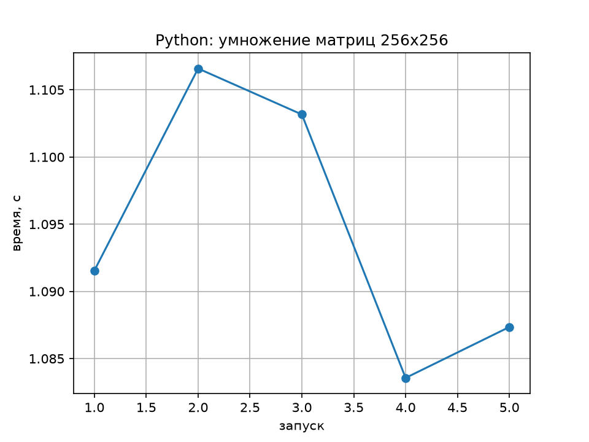
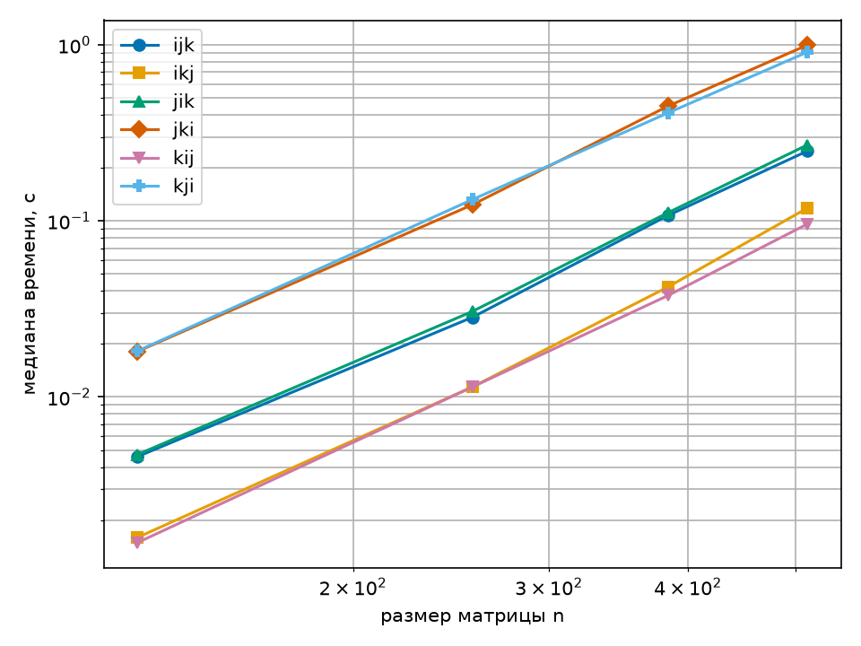
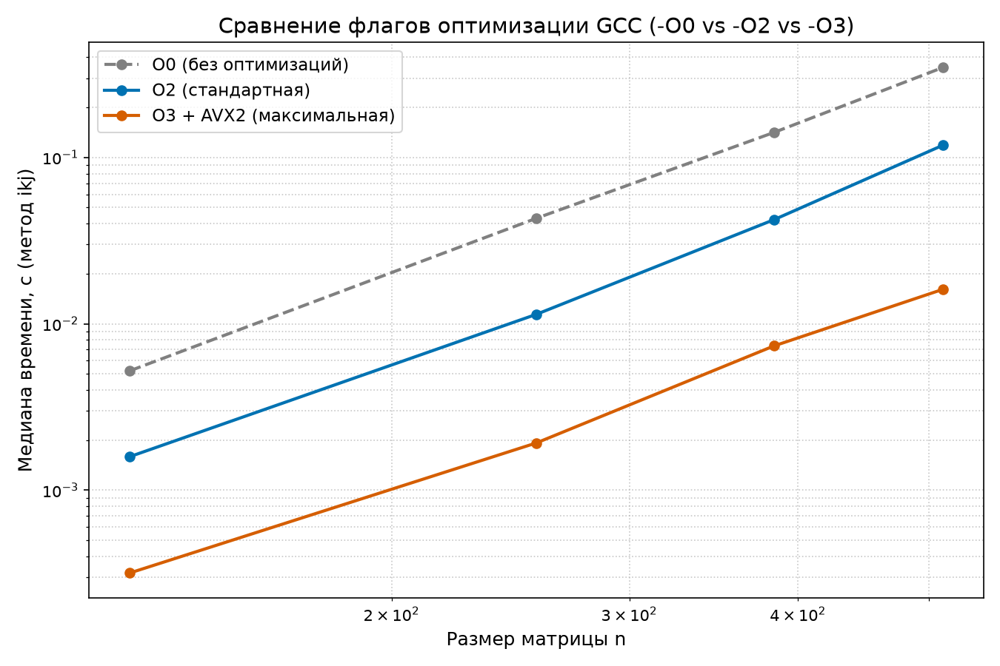
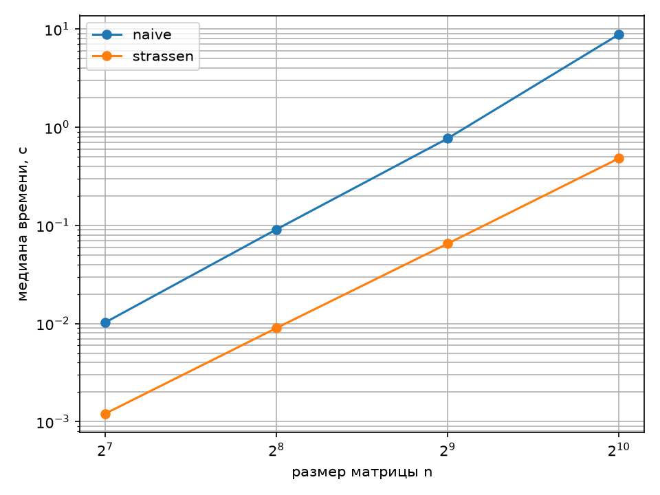

# Лабораторная работа: Архитектура компьютера и оптимизация умножения матриц

Исследование производительности матричного умножения $C = A \times B$: от интерпретируемого Python до компилируемого кода на C с перестановкой циклов, анализом кэш-памяти, векторизацией AVX2/FMA и алгоритмом Штрассена.

---

## Структура репозитория

* **Часть 1 (Анализ CPU):** `O.py` — скрипт определения характеристик процессора, кэша и расчета пиковых GFLOPS.
* **Часть 2 (Python):** `student.py` (реализация $O(n^3)$), `bench.py` (бенчмарк), `plot_python.py`, `python-matmul.csv`, `python-matmul.png`.
* **Часть 3 и 4 (Язык C — 6 порядков циклов и флаги):** `matmul.c`, `plot_c.py`, `plot_all_flags.py`, `part4_table.py`, таблицы `matmul.csv` (`-O2`), `matmul-O0.csv`, `matmul-O3.csv` и графики `matmul-orders.png`, `matmul-flags-comparison.png`.
* **Часть 5 (Алгоритм Штрассена):** `strassen.c`, `plot_strassen.py`, `strassen.csv`, `strassen.png`.

---

## Часть 1. Устройство компьютера

Замеры выполнены на процессоре **AMD Ryzen 5 4600H** (микроархитектура Zen 2, `AMD64`):
* **Ядра и потоки:** 6 физических ядер, 12 логических потоков (`os.cpu_count() = 12`).
* **Базовая частота:** 3.00 ГГц (3000 МГц).
* **Кэш-память:**
  * **L1:** 384 КБ суммарно (по 32 КБ L1d + 32 КБ L1i на ядро).
  * **L2:** 3072 КБ суммарно (по 512 КБ на ядро).
  * **L3:** 8192 КБ (8 МБ общий).
* **Векторные инструкции:** поддержка **AVX2** (`avx2 = True`, ширина вектора $W = 8$ для FP32 / $W = 4$ для FP64), `avx512f = False`.

### Оценка пиковой производительности одного ядра (FP32)
* Базовая формула ($f \times W$): $3.0 \times 8 = \mathbf{24.0\text{ GFLOPS}}$.
* С учетом FMA ($f \times W \times 2$, умножение + сложение за такт): $3.0 \times 8 \times 2 = \mathbf{48.0\text{ GFLOPS}}$.
* Полный аппаратный пик ядра Zen 2 (2 конвейера FMA): $\mathbf{96.0\text{ GFLOPS}}$ (для `double` / FP64 — $\mathbf{48.0\text{ GFLOPS}}$ на 2 конвейера или $\mathbf{24.0\text{ GFLOPS}}$ на 1 конвейер).

### Теоретические ответы
* **Что такое такт:** один элементарный шаг работы процессора, синхронизируемый генератором тактовой частоты (при 3.0 ГГц ядро выполняет 3 млрд тактов в секунду).
* **Зачем ядру кэш:** оперативная память (RAM) работает слишком медленно (обращение занимает сотни тактов). Кэш (L1/L2/L3) — сверхбыстрая память внутри процессора, хранящая текущие данные и инструкции, чтобы ядро не простаивало.
* **Почему ядер несколько:** увеличение частоты одного ядра выше 4–5 ГГц приводит к нелинейному росту энергопотребления и перегреву. Поэтому производительность масштабируют за счет размещения нескольких ядер на одном кристалле.

---

## Часть 2. Умножение матриц на Python ($n = 256$)

Реализовано классическое умножение матриц $O(n^3)$ в `student.py`. По 5 запускам (`bench.py`):
* **Медиана времени:** `1.091551 с` (разброс от `1.083562 с` до `1.106583 с`).
* **Медианная производительность:** `0.0307 GFLOPS`.

### Ответы на вопросы
1. **Почему оценка для $n = 1024$ получается умножением на 64?**
   Алгоритм имеет кубическую сложность $O(n^3)$. При увеличении размера матрицы в 4 раза ($1024 / 256 = 4$) число операций возрастает в $4^3 = \mathbf{64\text{ раза}}$ (прогноз времени: $1.092 \times 64 \approx 70\text{ с}$).
2. **Сколько операций делает умножение матриц $1024 \times 1024$?**
   Для каждого из $n^2$ элементов результата выполняется $n$ умножений и $n$ сложений: $2n^3 = 2 \times 1024^3 = \mathbf{2\,147\,483\,648}$ операций с плавающей точкой ($\approx 2.15\text{ ГФЛОП}$).

---

## Часть 3 и 4. Язык C: все шесть порядков циклов и флаги компиляции

### 1. Проверка корректности (`control`)
Во всех шести порядках (`ijk`, `ikj`, `jik`, `jki`, `kij`, `kji`) контрольный элемент `c[7][7]` совпадает бит в бит при каждом размере матрицы (`36.143351` для $n=128$, `63.283563` для $n=256$, `94.155848` для $n=384$, `128.735066262` для $n=512$), так как накопление суммы по индексу `k` для фиксированной ячейки идет в одинаковом порядке.

### 2. Таблица медиан времени (сек) для базовой сборки `-O2` (`matmul.csv`)

| Порядок | $n = 128$ | $n = 256$ | $n = 384$ | $n = 512$ | Характер доступа к памяти во внутреннем цикле |
| :--- | :---: | :---: | :---: | :---: | :--- |
| **ijk** | 0.004579 | 0.028346 | 0.107563 | 0.249507 | `a[i][k]` по строке, `b[k][j]` по столбцу (средний) |
| **ikj** | **0.001591** | **0.011398** | **0.042266** | **0.118291** | `b[k][j]` и `c[i][j]` подряд по строке (**быстрый**) |
| **jik** | 0.004706 | 0.030600 | 0.111560 | 0.270233 | `a[i][k]` по строке, `b[k][j]` по столбцу (средний) |
| **jki** | 0.018117 | 0.123582 | 0.449762 | 0.997709 | `a[i][k]` и `c[i][j]` по столбцам (медленный) |
| **kij** | **0.001487** | **0.011398** | **0.037769** | **0.096041** | `b[k][j]` и `c[i][j]` подряд по строке (**быстрый**) |
| **kji** | 0.018236 | 0.132255 | 0.411344 | 0.909786 | `a[i][k]` и `c[i][j]` по столбцам (медленный) |

### 3. Анализ результатов (Часть 3 и 4)
* **Маленькие и большие матрицы:** И на малых ($n=128$), и на больших ($n=512$) матрицах быстрее всего работают порядки **`kij`** и **`ikj`** (обход памяти подряд по строкам с шагом 8 байт, максимальное попадание в кэш L1d), а медленнее всего — **`jki`** и **`kji`** (обход по столбцам, постоянные промахи кэша).
* **Как меняется разрыв:** В относительном выражении худшие порядки стабильно медленнее лучших в **10.4–12.3 раза**. В абсолютном выражении разрыв растет кубически с `0.0167 с` (при $n=128$) до `0.9017 с` (при $n=512$).
* **Наклон графика:** В логарифмических осях линии имеют наклон около **3** из-за сложности $O(n^3)$. На правом краю ($n=384 \to 512$) наклон становится чуть круче ($>3$), так как три матрицы при $n=512$ занимают $3 \times 512^2 \times 8 = 6\text{ МБ}$ и перестают помещаться в кэш L2 одного ядра (512 КБ).
* **Сравнение флагов (`-O0`, `-O2`, `-O3 -march=native`) и Python:**
  На размере $n=256$ (метод `ikj`) переход с Python (`1.091551 с`) на C `-O0` (`0.043066 с`) дает ускорение в **25.3 раза**, на C `-O2` (`0.011398 с`) — в **95.8 раза**, а на C `-O3 -march=native` (`0.001922 с`, `17.45 GFLOPS`) — в **567.9 раза** за счет автовекторизации AVX2 и инструкций FMA.

### 4. Анализ ассемблера в Godbolt (`x86-64 gcc -O2 -masm=intel`)
* **Внутренний цикл `mul_ijk` (по `k`, метка `.L4`):**
  Указатель на `a[i][k]` (`rdx`) сдвигается подряд на соседний элемент (`add rdx, 8`), тогда как указатель на матрицу **`b[k][j]` (`rax`) идет с шагом в целую строку** — каждую итерацию прыгает на **6144 байта** (`add rax, 6144`, так как `MAXN * sizeof(double) = 768 * 8 = 6144`).
* **Внутренний цикл `mul_ikj` (по `j`):**
  Элемент `a[i][k]` один раз загружается в регистр до цикла, а обращения к **`b[k][j]`** и `c[i][j]` идут **строго подряд** по строке (шаг `+8` или `+16` байт без прыжков на `6144`).

---

## Часть 5. Алгоритм Штрассена ($O(n^{\log_2 7})$)

Реализовано рекурсивное разбиение матриц на 4 блока $m \times m$ ($m = n/2$) с вычислением 7 произведений $M_1 \dots M_7$ вместо 8 и переходом на базовое построчное умножение (`base_mul` с порядком `ikj`) при размере блока `THRESHOLD <= 64`. Предусмотрено автоматическое дополнение нулями, если $n$ не является степенью двойки.

### Результаты замеров (`strassen.csv`)

| Размер $n$ | Время `naive` (с) | Время `strassen` (с) | GFLOPS (`naive` / `strassen`) | Ускорение | `maxdiff` (`strassen`) |
| :---: | :---: | :---: | :---: | :---: | :---: |
| **128** | 0.010796 | 0.001658 | 0.389 / 2.530 | **6.5x** | `5.684e-14` |
| **256** | 0.091145 | 0.009003 | 0.368 / 3.727 | **10.1x** | `2.700e-13` |
| **512** | 0.799875 | 0.065175 | 0.336 / 4.119 | **12.3x** | `1.307e-12` |
| **1024** | 8.255967 | 0.462795 | 0.260 / 4.640 | **17.8x** | `5.599e-12` |

### Выводы по алгоритму Штрассена и `maxdiff`
1. **Производительность:** На матрице $1024 \times 1024$ алгоритм Штрассена работает в **17.8 раза быстрее** эталонного `naive` (`0.463 с` против `8.256 с`) как за счет меньшей асимптотической сложности $O(n^{2.807})$, так и за счет локальности данных в кэше L1/L2 на базовом уровне рекурсии ($64 \times 64$).
2. **Точность (`maxdiff`):** У `naive` расхождение с эталоном равно `0.000e+00`. У алгоритма Штрассена `maxdiff` составляет $5.68 \times 10^{-14} \dots 5.60 \times 10^{-12}$. Так как сложение чисел `double` неассоциативно из-за округления младших разрядов мантиссы ($\varepsilon \approx 2.2 \times 10^{-16}$), иной порядок сложений и вычитаний блоков ($M_1 \dots M_7$) дает расхождение лишь в последних битах мантиссы, что подтверждает корректность реализации.
